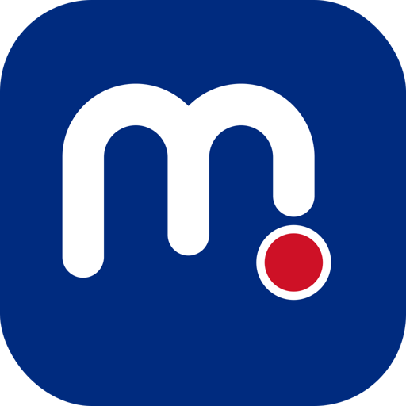
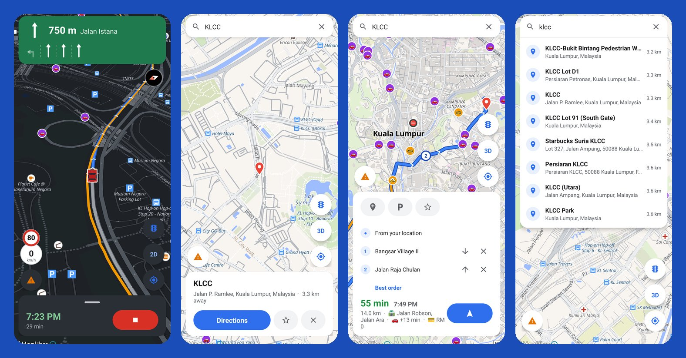

  

<h1 align="center">Roadwise</h1>

  <b>Free driving directions for Malaysia, with live traffic and reports from other drivers.</b> 
  No ads, no accounts, no Google services. Built on OpenStreetMap.

  <a href="https://github.com/ycryga/roadwise-releases/releases/latest"><b>⬇️ Download for Android</b></a>
  &nbsp;·&nbsp;
  <a href="https://ycryga.github.io/roadwise-releases/"><b>🌐 Open in your browser</b></a> (iPhone too)
  &nbsp;·&nbsp;
  <a href="ROADMAP.md">🗺️ What's coming</a>

  

## What it does

**Getting there**
- Turn-by-turn voice directions with lane arrows, and up to three routes to choose from
- Arrival times that count today's traffic, with slow and stopped stretches coloured on the route
- Several stops on the way, in any order, or let **Best order** pick the quickest
- Toll prices for each route, and which choice is toll-free when there is one
- Plan a trip from anywhere, not just where you are now

**On the road**
- Your speed against the limit, flashing red when you go over
- Warnings for speed cameras, toll plazas, railway crossings and speed bumps
- Reports from other drivers: police, accidents, traffic, hazards, closed roads
- Keeps directing you with the phone locked or folded (Galaxy Flip cover screen too)
- Dark map and panels after sunset and in tunnels

**Finding places**
- Search in English or Malay: "stesen minyak", "makan", "surau", "parking"
- Paste a link or share a location from WhatsApp or Google Maps
- Petrol, food and toilets along your route, each showing how much time it adds
- Routing maps you can download, so directions work without signal
- Give any place a name and keep it, even a dropped pin or typed coordinates
- Add a shop, stall or workshop the map is missing, and every driver finds it in search

## Install on Android

1. On your Android phone (Android 8 or newer), download `roadwise-vX.Y.Z.apk` from the
   **[latest release](https://github.com/ycryga/roadwise-releases/releases/latest)**.
2. Open it. If Android asks, allow your browser to install apps.
3. Open Roadwise and allow location. Allow notifications too, to keep directions coming with the
   screen off.

Updates install over the old version and keep your saved places. Only install Roadwise from this
page: every release is signed with the same key, and Android refuses an update signed with another.

## Or use it in your browser

Nothing to install, and it works on iPhone. Open
**[ycryga.github.io/roadwise-releases](https://ycryga.github.io/roadwise-releases/)**, then add it
to your home screen (Chrome: ⋮ → Add to Home screen; Safari: Share → Add to Home Screen).

It has search, routes with live traffic, voice directions, stops, drivers' reports and the traffic
map. Keep it open on screen while driving: browsers stop directions when the screen locks. The
Android app keeps going with the screen off and also has tolls, speed cameras, lanes and offline
routing.

## Your privacy

Roadwise has no accounts, ads or tracking, and doesn't keep a record of where you drive. Sharing
your waits at traffic lights, which improves everyone's arrival times, is off unless you turn it on.
The [privacy page](PRIVACY.md) lists exactly what is sent, to whom, and why.

## Help make it better

- **Ideas?** Use **💡 Request a feature** in the app.
- **Found a bug or a wrong speed limit?** [Open an issue](https://github.com/ycryga/roadwise-releases/issues).
- **Wrong road, missing place or traffic light?** Fix it on [OpenStreetMap](https://www.openstreetmap.org),
  which Roadwise reads from, and everyone benefits.
- **Support Roadwise:** it's free with no ads; donations pay for live traffic and the servers.
  Use **☕ Support Roadwise** in the app (DuitNow) or [Ko-fi](https://ko-fi.com/ycryga).

See [what's new](CHANGELOG.md) in each release.

---

Made in Malaysia by [@ycryga](https://github.com/ycryga), built with [Claude Code](https://claude.com/claude-code).
Map data © OpenStreetMap contributors (ODbL). Live traffic © TomTom.
